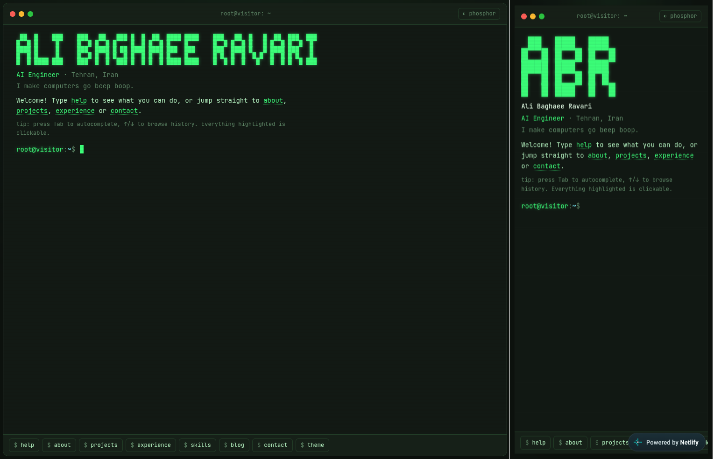

# terminal-folio — a terminal-style portfolio

A personal portfolio you explore by typing. Visitors land in a retro terminal and use commands like `about`, `projects`, `experience`, and `contact` to navigate. Every command shown on screen is also clickable, and a quick-command bar makes it easy to use on phones.



## Features

- **Sections:** about, skills, experience, education, projects (with per-project details), blog (readable in the terminal), resume, socials, and contact
- **Real terminal feel:** tab completion with inline ghost suggestions, ↑/↓ history, `Ctrl+L` to clear, `Ctrl+C` to cancel, "did you mean…" suggestions
- **Contact form in the prompt:** `contact` walks visitors through name → email → message → confirm, then submits through Netlify Forms
- **Themes:** `theme phosphor | amber | midnight | paper` (remembered per browser)
- **Deep links:** `/?cmd=projects` runs a command on load
- **Easter eggs:** try `neofetch`, `sudo hire me`, `coffee`, `rm -rf /`…

## Make it yours

| What                                    | Where                                      |
| --------------------------------------- | ------------------------------------------ |
| Name, role, bio, skills, socials, email | `src/data/profile.ts`                      |
| Jobs                                    | `content/jobs/*.md`                        |
| Education                               | `content/education/*.md`                   |
| Projects                                | `content/projects/*.md`                    |
| Blog posts                              | `content/blog/*.md`                        |
| Colors / themes                         | `src/styles.css` (`.t-root[data-theme=…]`) |

The ASCII banner is generated automatically from your name.

The project was designed to run on netlify. You can make a new account and publish it as it is in [here](https://www.netlify.com/signup)

## Tech

TanStack Start (React 19) · Vite · Tailwind CSS 4 · Content Collections (typed markdown).

## Run locally

```bash
npm install
npm run dev
```

Contact submissions are handled by Netlify Forms on the deployed site, so final submission cannot be tested with `npm run dev`.
